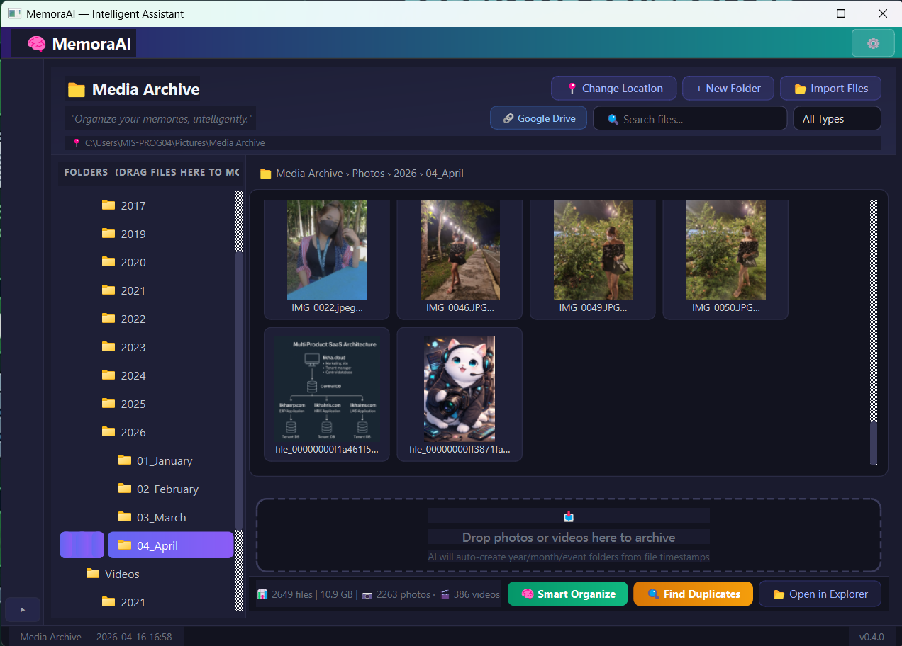
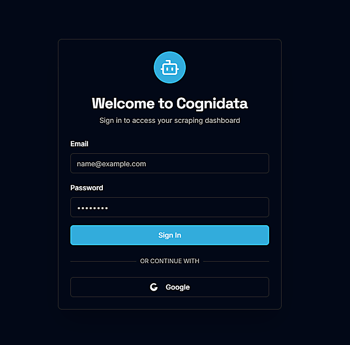
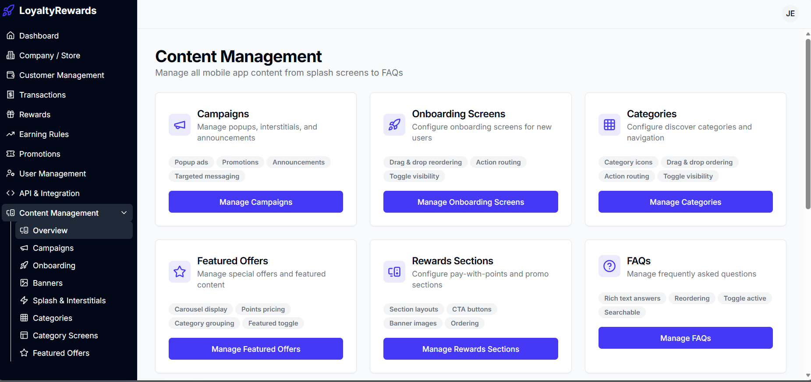
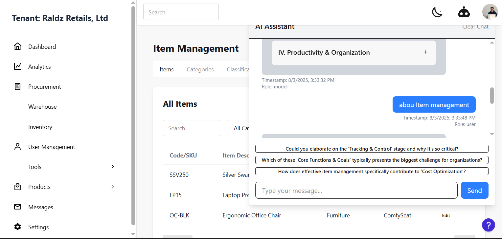
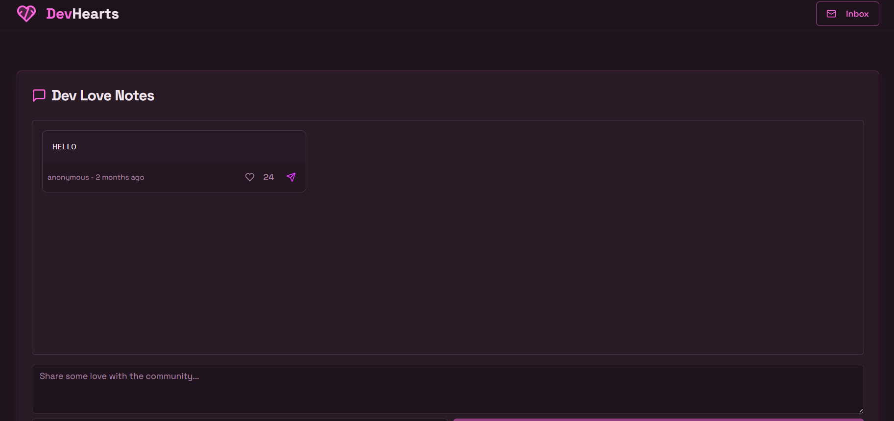
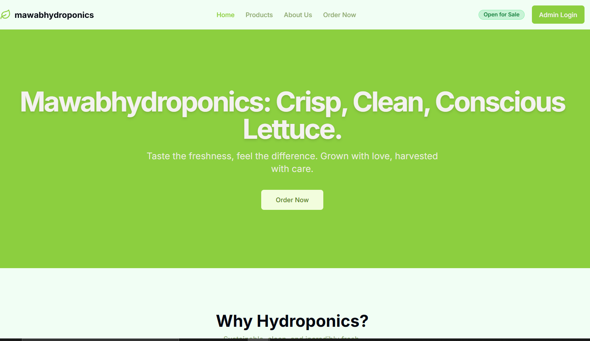
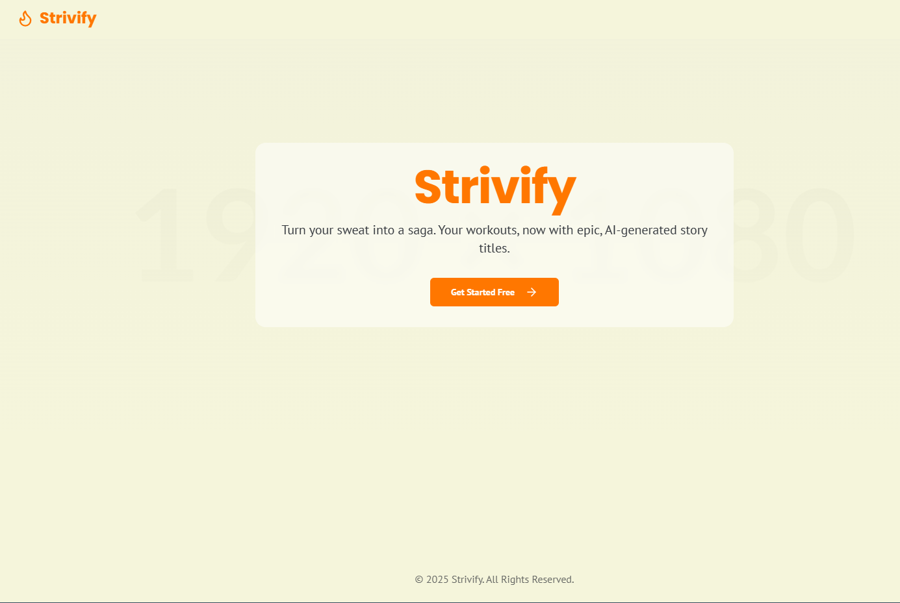
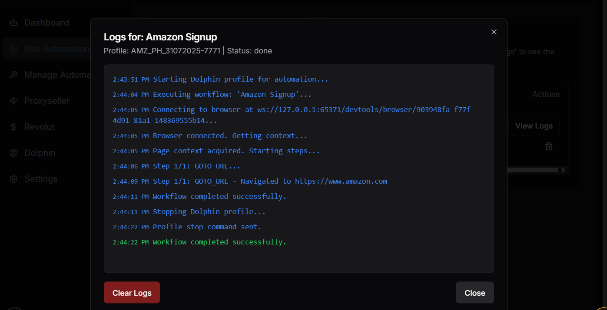

<!-- ================= ANIMATED HERO HEADER ================= -->
<p align="center">
  <a href="https://jeraldjose.vercel.app/">
    
  </a>
</p>

<!-- Laser traveling beam divider -->
<p align="center">
  
</p>

<!-- Infinite animated skill pills sliding marquee -->
<p align="center">
  
</p>

<p align="center">
  
</p>

<p align="center">
  <a href="https://jeraldjose.vercel.app/">
    
  </a>
</p>

<p align="center">
  <a href="https://jeraldjose.vercel.app/"></a>
  <a href="https://www.linkedin.com/in/jeraldjose/"></a>
  <a href="mailto:jeraldjose16@gmail.com"></a>
  <a href="https://web.facebook.com/jerald.jose.316"></a>
  <a href="https://wa.me/qr/SP5SZZGGVJ3SE1"></a>
  <a href="https://buymeacoffee.com/r47dzt3ch"></a>
  <a href="./JeraldJose(Resume).pdf"></a>
</p>

<p align="center">
  
  <a href="https://github.com/r47dzt3ch?tab=followers"></a>
</p>

---

## 👨‍💻 About Me

```kotlin
object Jerald : Developer {
    val handle      = "r47dzt3ch"
    val role        = "Full-Stack Developer / MIS Programmer"
    val location    = "Philippines 🇵🇭"
    val focus       = listOf("Laravel + Vue", "Next.js", "Kotlin Multiplatform", "AI & Computer Vision", "Acumatica ERP", "IoT")
    val currentlyOn = listOf("Multi-tenant SaaS ERP", "Loyalty & Rewards Platforms", "Edge AI / YOLO vision systems")
    val funFact     = "I ship web, mobile, desktop AND firmware — sometimes in the same week ☕"
}
```

I build **efficient, secure, and scalable systems** — from CRMs and POS platforms to AI-powered desktop apps and IoT devices.

- 🏢 Customizing **Acumatica ERP** (C# Graph/DAC extensions, Report Designer, Crystal Reports)
- 📱 Shipping cross-platform apps with **Kotlin Multiplatform + Compose Multiplatform**
- 🤖 Building **computer vision & AI agents** with YOLOv8, PyTorch, OpenCV, Gemini & Ollama
- 🔐 Also offering **web security testing**, **AI task automation**, and **IT career mentoring**
- 💬 Ask me about **Laravel, Vue, Next.js, FastAPI, KMP, Firebase**

---

## 🛠️ Tech Stack

<h3 align="center">💻 Languages</h3>
<p align="center">
  
  <br/>
  
  
  
</p>

<h3 align="center">🌐 Frontend & Web</h3>
<p align="center">
  
  <br/>
  
  
  
  
  
</p>

<h3 align="center">⚙️ Backend & APIs</h3>
<p align="center">
  
  <br/>
  
  
  
</p>

<h3 align="center">📱 Mobile & Desktop</h3>
<p align="center">
  
  <br/>
  
  
  
  
  
  
  
</p>

<h3 align="center">🗄️ Databases & Cloud</h3>
<p align="center">
  
  <br/>
  
  
</p>

<h3 align="center">🤖 AI • Automation • IoT</h3>
<p align="center">
  
  <br/>
  
  
  
  
  
  
  
  
  
  
  
  
  
</p>

<h3 align="center">🏢 ERP • Tools</h3>
<p align="center">
  
  
  
  <br/><br/>
  
</p>

---

## 🚀 Projects

> 🌐 See every project with full details on my portfolio → **[jeraldjose.vercel.app](https://jeraldjose.vercel.app/#projects)**

### 🤖 AI & Computer Vision

<table>
  <tr>
    <td width="33%" valign="top" align="center">
      
      <h4>👁️ SmartVision Mainframe</h4>
      <sub>Multi-camera edge-AI platform — face recognition, traffic monitoring & security alarms with auto IP-camera discovery.</sub><br/><br/>
      <code>Python</code> <code>PyQt6</code> <code>FastAPI</code> <code>YOLOv8</code> <code>PyTorch</code> <code>OpenCV</code><br/><br/>
      <a href="https://jeraldjose.vercel.app/#contact"></a>
    </td>
    <td width="33%" valign="top" align="center">
      
      <h4>📷 NeuroCam</h4>
      <sub>Turns Android phones into low-latency MJPEG streaming nodes for SmartVision via an embedded Ktor server.</sub><br/><br/>
      <code>Kotlin</code> <code>Compose</code> <code>CameraX</code> <code>Ktor</code> <code>FastAPI</code><br/><br/>
      <a href="https://jeraldjose.vercel.app/#contact"></a>
    </td>
    <td width="33%" valign="top" align="center">
      
      <h4>🧭 AXI Co-Pilot</h4>
      <sub>Conversational AI assistant & browser-automation platform with voice responses, execution plans and a live dashboard.</sub><br/><br/>
      <code>Python</code> <code>PyQt6</code> <code>MediaPipe</code> <code>ADB</code> <code>AI</code><br/><br/>
      <a href="https://jeraldjose.vercel.app/#contact"></a>
    </td>
  </tr>
  <tr>
    <td width="33%" valign="top" align="center">
      <a href="https://github.com/r47dzt3ch/Memora_ai"></a>
      <h4>🧠 MemoraAI</h4>
      <sub>Desktop AI assistant for smart media archiving, document organization & workflow automation with audit trails.</sub><br/><br/>
      <code>Python</code> <code>PyQt6</code> <code>SQLite</code> <code>CV & NLP</code><br/><br/>
      <a href="https://github.com/r47dzt3ch/Memora_ai"></a>
    </td>
    <td width="33%" valign="top" align="center">
      <a href="https://cognidata.netlify.app/"></a>
      <h4>📊 Cognidata</h4>
      <sub>Automation workflow platform — email automation & API auto-bots powered by autonomous AI agents.</sub><br/><br/>
      <code>Next.js</code> <code>Python</code> <code>Firebase</code> <code>AI</code><br/><br/>
      <a href="https://cognidata.netlify.app/"></a>
    </td>
    <td width="33%" valign="top" align="center">
      <a href="https://whisperchat-hub.netlify.app/"></a>
      <h4>💬 WhisperChat</h4>
      <sub>Real-time anonymous chat with Gemini-powered matchmaking, moderation, presence & local voice notes.</sub><br/><br/>
      <code>Next.js</code> <code>TypeScript</code> <code>Firebase</code> <code>Zustand</code> <code>shadcn/ui</code><br/><br/>
      <a href="https://whisperchat-hub.netlify.app/"></a>
    </td>
  </tr>
</table>

### 📱 Mobile & Multiplatform

<table>
  <tr>
    <td width="33%" valign="top" align="center">
      
      <h4>💰 Badyet AI</h4>
      <sub>Personal finance app with Gemini receipt scanning, smart budget allocation & forecasting on Android and iOS.</sub><br/><br/>
      <code>KMP</code> <code>Compose MP</code> <code>SwiftUI</code> <code>SQLDelight</code> <code>Ktor</code><br/><br/>
      <a href="https://jeraldjose.vercel.app/#contact"></a>
    </td>
    <td width="33%" valign="top" align="center">
      <a href="https://loyaltyreward.netlify.app/"></a>
      <h4>🎁 SmartForge Rewards</h4>
      <sub>Tenant loyalty rewards app (Android, iOS, Desktop) with a Next.js admin panel for rewards management.</sub><br/><br/>
      <code>KMP</code> <code>Kotlin</code> <code>Next.js</code> <code>Firebase</code><br/><br/>
      <a href="https://loyaltyreward.netlify.app/"></a>
    </td>
    <td width="33%" valign="top" align="center">
      <a href="https://github.com/r47dzt3ch/PresenterProApp"></a>
      <h4>🎤 PresenterProApp</h4>
      <sub>Cross-platform BLE presentation remote sharing logic & UI across Android and iOS.</sub><br/><br/>
      <code>KMP</code> <code>Jetpack Compose</code> <code>SwiftUI</code> <code>BLE</code><br/><br/>
      <a href="https://github.com/r47dzt3ch/PresenterProApp"></a>
    </td>
  </tr>
</table>

### 🌐 Web & SaaS

<table>
  <tr>
    <td width="33%" valign="top" align="center">
      
      <h4>🏭 LIKHAERP</h4>
      <sub>Multi-tenant SaaS ERP (SPA + PWA) with offline support and Demo / Basic / Pro / Enterprise plans.</sub><br/><br/>
      <code>Laravel</code> <code>Vue.js</code> <code>Tailwind</code> <code>MySQL</code><br/><br/>
      <a href="https://jeraldjose.vercel.app/#contact"></a>
    </td>
    <td width="33%" valign="top" align="center">
      <a href="https://sendhearts.netlify.app/"></a>
      <h4>💖 DevHearts</h4>
      <sub>Community platform where developers exchange real-time appreciation, encouragement & virtual hearts.</sub><br/><br/>
      <code>React</code> <code>TypeScript</code> <code>Tailwind</code> <code>Firebase</code><br/><br/>
      <a href="https://sendhearts.netlify.app/"></a>
      <a href="https://github.com/r47dzt3ch/DevHearts"></a>
    </td>
    <td width="33%" valign="top" align="center">
      <a href="https://mawabhydroponics.netlify.app/"></a>
      <h4>🥬 Mawab Hydroponics Lettuce</h4>
      <sub>Smart hydroponics management with AI planning, orders & inventory for lettuce cultivation.</sub><br/><br/>
      <code>Next.js</code> <code>React</code> <code>Firebase</code> <code>AI</code><br/><br/>
      <a href="https://mawabhydroponics.netlify.app/"></a>
    </td>
  </tr>
  <tr>
    <td width="33%" valign="top" align="center">
      
      <h4>🏃 Strivify</h4>
      <sub>Turns Strava workouts into shareable stories with photos, videos & AI-generated captions.</sub><br/><br/>
      <code>Next.js</code> <code>React</code> <code>Tailwind</code> <code>AI</code><br/><br/>
      <a href="https://buymeacoffee.com/r47dzt3ch"></a>
    </td>
    <td width="33%" valign="top" align="center">
      
      <h4>🛒 Revolut Amazon Bot Automation</h4>
      <sub>Amazon task automation (price monitoring, inventory, orders) with AI and anti-detect browser security.</sub><br/><br/>
      <code>Python</code> <code>Next.js</code> <code>Firebase</code> <code>AI</code><br/><br/>
      <a href="https://jeraldjose.vercel.app/#contact"></a>
    </td>
    <td width="33%" valign="top" align="center">
      <a href="https://github.com/r47dzt3ch/splacecoworkingplace"></a>
      <h4>📇 Splace Lead Profiler</h4>
      <sub>BPO lead profiling & verification system with Python automation, built for Splace co-working.</sub><br/><br/>
      <code>Python Flask</code> <code>MySQL</code> <code>Automation</code><br/><br/>
      <a href="https://github.com/r47dzt3ch/splacecoworkingplace"></a>
    </td>
  </tr>
</table>

### 🔌 IoT, Desktop & DevOps

<table>
  <tr>
    <td width="33%" valign="top" align="center">
      
      <h4>⚡ CircuitSync</h4>
      <sub>IoT device sync & control app with custom ESP8266 firmware driving relays and motors in real time.</sub><br/><br/>
      <code>KMP</code> <code>Firebase</code> <code>C++</code> <code>PlatformIO</code> <code>Koin</code><br/><br/>
      <a href="https://jeraldjose.vercel.app/#contact"></a>
    </td>
    <td width="33%" valign="top" align="center">
      
      <h4>🚚 DeployFlow</h4>
      <sub>Windows deployment orchestrator for branch offices — clears SMB locks, auto-backups & remote updates.</sub><br/><br/>
      <code>Python</code> <code>PyQt6</code> <code>FastAPI</code> <code>WebSockets</code> <code>PowerShell</code><br/><br/>
      <a href="https://jeraldjose.vercel.app/#contact"></a>
    </td>
    <td width="33%" valign="top" align="center">
      <a href="https://github.com/r47dzt3ch/presentation-remote"></a>
      <h4>⌚ Presentation Remote</h4>
      <sub>Control slides from a Zepp OS smartwatch over BLE with a Python Win32 desktop bridge.</sub><br/><br/>
      <code>Zepp OS</code> <code>JavaScript</code> <code>Python</code> <code>BLE</code><br/><br/>
      <a href="https://github.com/r47dzt3ch/presentation-remote"></a>
    </td>
  </tr>
  <tr>
    <td width="33%" valign="top" align="center">
      <a href="https://github.com/r47dzt3ch/PyPresenterPro"></a>
      <h4>🖥️ PyPresenterPro</h4>
      <sub>Open-source presentation tool & layout engine with an integrated BLE engine for external peripherals.</sub><br/><br/>
      <code>Python</code> <code>FastAPI</code> <code>PyQt6</code> <code>BLE</code><br/><br/>
      <a href="https://github.com/r47dzt3ch/PyPresenterPro"></a>
    </td>
    <td width="33%" valign="top" align="center">
      
      <h4>🌾 RySys</h4>
      <sub>IoT rice irrigation system controlled from an Android app to optimize water usage and crop yield.</sub><br/><br/>
      <code>Java</code> <code>Android</code> <code>Firebase</code> <code>IoT</code><br/><br/>
      <a href="https://buymeacoffee.com/r47dzt3ch/e/437655"></a>
    </td>
    <td width="33%" valign="top" align="center">
      <a href="https://github.com/r47dzt3ch/MyPython_Devs"></a>
      <h4>🐍 MyPython_Devs</h4>
      <sub>Collection of Python automation, scraping & AI utilities.</sub><br/><br/>
      <code>Python</code> <code>Selenium</code> <code>FastAPI</code> <code>OpenAI</code><br/><br/>
      <a href="https://github.com/r47dzt3ch/MyPython_Devs"></a>
    </td>
  </tr>
</table>

### 🎓 Desktop Systems (Early Work)

<table>
  <tr>
    <td width="33%" valign="top" align="center">
      
      <h4>🧾 LCC-SAMS</h4>
      <sub>Student Account Management System — complete deployable desktop app for student billing.</sub><br/><br/>
      <code>VB.NET</code> <code>MySQL</code><br/><br/>
      <a href="https://jeraldjose.vercel.app/#contact"></a>
    </td>
    <td width="33%" valign="top" align="center">
      <a href="https://github.com/r47dzt3ch/ninhs_sms"></a>
      <h4>🏫 NINHS-SMS</h4>
      <sub>School management system for Nuevo Iloco NHS — users, courses, modules, enrollment & progress tracking.</sub><br/><br/>
      <code>C#</code> <code>MySQL</code><br/><br/>
      <a href="https://github.com/r47dzt3ch/ninhs_sms"></a>
    </td>
    <td width="33%" valign="top" align="center">
      <a href="https://github.com/r47dzt3ch/Students_attendance_System"></a>
      <h4>🪪 Students Attendance System</h4>
      <sub>Attendance management with manual entry and RFID scanning, reports & data persistence.</sub><br/><br/>
      <code>C++</code> <code>MySQL</code> <code>RFID</code><br/><br/>
      <a href="https://github.com/r47dzt3ch/Students_attendance_System"></a>
    </td>
  </tr>
</table>

---

## 💼 Experience

| Role | Company | Period | Highlights |
|---|---|---|---|
| 🧑‍💻 **Lead Programmer (Intern)** | [Splace](https://splacebpo.com/) | Mar 2022 – Dec 2022 | Led the dev team delivering automation & internal systems for a BPO firm |
| 🌍 **Freelance Developer** | LinkedIn | Jan 2022 – Dec 2023 | Core project structures for automation, logistics, landing pages & scalable web apps |

## 🏆 Certificates & Achievements

<p>
  
  
  
  
  
</p>

---

<!-- Snake animation eating contributions -->
<p align="center">
  <picture>
    <source media="(prefers-color-scheme: dark)" srcset="./assets/github-snake-dark.svg" />
    <source media="(prefers-color-scheme: light)" srcset="./assets/github-snake.svg" />
    
  </picture>
</p>

<!-- Traveling laser divider -->
<p align="center">
  
</p>

<p align="center">
  <b>💡 “Turning ideas into clean, efficient, and modern solutions.”</b><br/>
  <sub>Thanks for visiting! Have a project in mind? <a href="https://jeraldjose.vercel.app/#contact">Let's talk</a> 👋</sub>
</p>

<p align="center">
  
</p>
